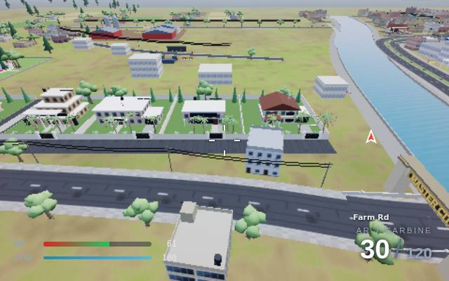
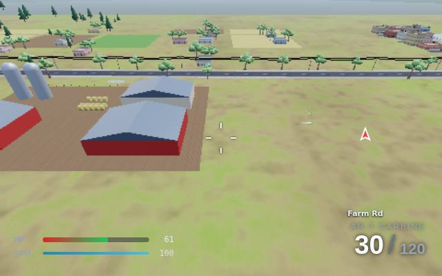
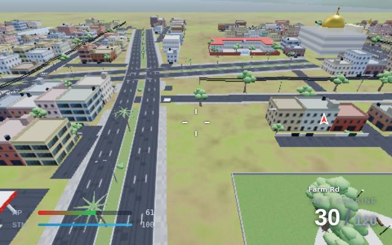
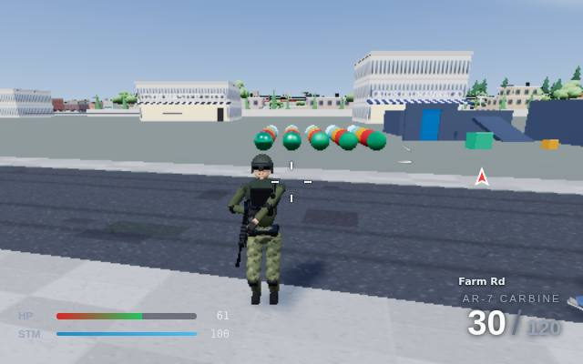

# Game report — 2026-11-24T07:33:14.740Z (day 2026-11-24, trigger: workflow_dispatch)

Rendering: **SIMULATED (software GL on a GitHub runner)**. Draw calls / triangles = real three.js counts (LIVE); walking/fighting = SIMULATED time; fps is NOT measured here.

## Bug summary
Major 3 · Minor 9 · open in ledger 13  (full list: LEDGER.md)

| ID | Severity | Type | Position (x,y,z) | Evidence | Confidence |
|---|---|---|---|---|---|
| GOKU-partner_gave_up-0 | Minor | partner_gave_up | -185, 0, 138.3 | no walkable path to the target, picked a new one / diagnosis: standable spot free, 3 solids within 3 m | EXACT |
| PERF--40_-170 | Major | over mobile budget | -40, 45, -170 | 893 draw calls (budget 150), 1107306 triangles (budget 300000) | EXACT |
| PERF-0_20 | Major | over mobile budget | 0, 45, 20 | 321 draw calls (budget 150), 556530 triangles (budget 300000) | EXACT |
| PERF--440_0 | Major | over mobile budget | -440, 45, 0 | 430 draw calls (budget 150), 618742 triangles (budget 300000) | EXACT |
| REF-vehicle-Ranger_4x4_offroad_suv_height_m_ | Minor | reference:vehicle:Ranger 4x4 (offroad_suv) height (m) | - | game 2.07 vs typical 1.65..2 (typical automotive spec ranges per body class (general manufacturer data)) | MEASURED |
| REF-vehicle-Ranger_4x4_offroad_suv_height_length | Minor | reference:vehicle:Ranger 4x4 (offroad_suv) height/length | - | game 0.487 vs typical 0.24..0.46 (typical automotive spec ranges per body class (general manufacturer data)) | MEASURED |
| REF-building-meridien_hotel_12_floors_storey_height_APPROX_m_ | Minor | reference:building:meridien (hotel, 12 floors) storey height APPROX (m) | - | game 5.1 vs typical 2.6..5 (typical floor-to-floor heights (residential ~2.7-3.2 m, commercial up to ~3.6-4.2 m)) | APPROX |
| REF-building-vu_university_3_floors_storey_height_APPROX_m_ | Minor | reference:building:vu (university, 3 floors) storey height APPROX (m) | - | game 8.029 vs typical 2.6..5 (typical floor-to-floor heights (residential ~2.7-3.2 m, commercial up to ~3.6-4.2 m)) | APPROX |
| REF-building-ashraf_palace_wedding_3_floors_storey_height_APPROX_m_ | Minor | reference:building:ashraf-palace (wedding, 3 floors) storey height APPROX (m) | - | game 8.867 vs typical 2.6..5 (typical floor-to-floor heights (residential ~2.7-3.2 m, commercial up to ~3.6-4.2 m)) | APPROX |
| REF-building-nazari_palace_wedding_3_floors_storey_height_APPROX_m_ | Minor | reference:building:nazari-palace (wedding, 3 floors) storey height APPROX (m) | - | game 5.833 vs typical 2.6..5 (typical floor-to-floor heights (residential ~2.7-3.2 m, commercial up to ~3.6-4.2 m)) | APPROX |
| REF-building-school_1_school_2_floors_storey_height_APPROX_m_ | Minor | reference:building:school-1 (school, 2 floors) storey height APPROX (m) | - | game 5.063 vs typical 2.6..5 (typical floor-to-floor heights (residential ~2.7-3.2 m, commercial up to ~3.6-4.2 m)) | APPROX |
| REF-building-school_2_school_2_floors_storey_height_APPROX_m_ | Minor | reference:building:school-2 (school, 2 floors) storey height APPROX (m) | - | game 5.063 vs typical 2.6..5 (typical floor-to-floor heights (residential ~2.7-3.2 m, commercial up to ~3.6-4.2 m)) | APPROX |

## What GOKU saw (screenshots, replaced every run)
Pictures are in `shots/`. Flags are pixel-statistics HEURISTICS (limits: entropy ≥ 3 bits, one colour ≤ 60%, edge density ≥ 0.04, contrast ≥ 60); "changed" = share of pixels that differ from the previous run's picture of the same spot (a big change after a code update is normal).

| Spot | Picture | Entropy | Edges | Contrast | Brightness | Flags | Changed vs last run |
|---|---|---|---|---|---|---|---|
| cell_-40_-170 |  | 6.71 | 0.332 | 127 | 150.6 | - | 0.1% |
| cell_0_20 |  | 5.24 | 0.153 | 77 | 161.6 | - | 0.1% |
| cell_-440_0 |  | 6.6 | 0.385 | 117 | 147 | - | 0.1% |
| spawn |  | 5.29 | 0.166 | 129 | 144.3 | - | 0.7% |

## GOKU vs real-world references (112 measurements)
vehicle: 38 in range, 2 outside, 0 no data · human: 12 in range, 0 outside, 0 no data · joints: 40 in range, 0 outside, 0 no data · ground-contact: 2 in range, 0 outside, 0 no data · building: 12 in range, 6 outside, 0 no data

Typical ranges, not one specific model. Full table: REFERENCE.md. NOT measurable yet: 9 things (listed in REFERENCE.md).

| Domain | Subject | What | Game | Typical range | Severity |
|---|---|---|---|---|---|
| vehicle | Ranger 4x4 (offroad_suv) | height (m) | 2.07 | 1.65..2 | Minor |
| vehicle | Ranger 4x4 (offroad_suv) | height/length | 0.487 | 0.24..0.46 | Minor |
| building | meridien (hotel, 12 floors) | storey height APPROX (m) | 5.1 | 2.6..5 | Minor |
| building | vu (university, 3 floors) | storey height APPROX (m) | 8.029 | 2.6..5 | Minor |
| building | ashraf-palace (wedding, 3 floors) | storey height APPROX (m) | 8.867 | 2.6..5 | Minor |
| building | nazari-palace (wedding, 3 floors) | storey height APPROX (m) | 5.833 | 2.6..5 | Minor |
| building | school-1 (school, 2 floors) | storey height APPROX (m) | 5.063 | 2.6..5 | Minor |
| building | school-2 (school, 2 floors) | storey height APPROX (m) | 5.063 | 2.6..5 | Minor |

## Performance samples (budget 150 draw calls / 300000 triangles)
| Cell (x,z) | Draw calls | Triangles | Geometries | Textures |
|---|---|---|---|---|
| -40, -170 | 893 | 1107306 | 544 | 69 |
| 0, 20 | 321 | 556530 | 544 | 69 |
| -440, 0 | 430 | 618742 | 592 | 74 |

## NOT verified
- real GPU frame rate (software GL here): draw calls/triangles are real counts, fps is not
- real Rapier physics if this run used the preview stub
- partner only walks/fights: no driving, invulnerable
- screenshots are judged by pixel statistics only (heuristics); a person or Claude must look at the pictures for real art quality
- reference ranges are TYPICAL values for a class (not one specific car model/person): outside the range = "go and look"
- faces, stairs/doors, car look vs real photos, clothing clipping: see goku_knowledge/references.json notMeasurableYet
- the Windows GOKU agent is NOT part of this run
